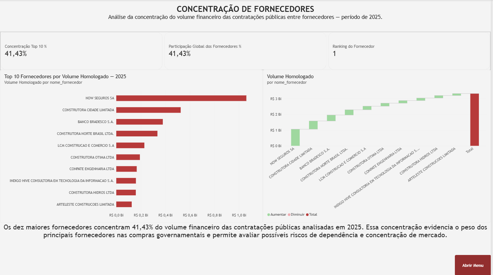
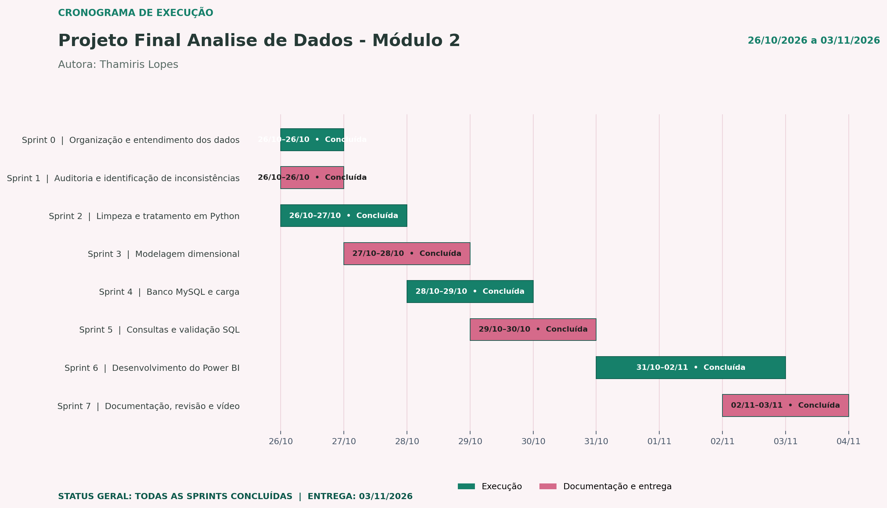

# Transparência nas Compras Públicas

### Análise de dados do PNCP \| Projeto Avaliativo -- Módulo 2

**Autora:** Thamiris Lopes\
**Período de desenvolvimento:** 26/10/2026 a 03/11/2026\
**Fonte:** Portal Nacional de Contratações Públicas (PNCP) -- dados
fornecidos para o projeto\
**Ano analisado:** 2025

------------------------------------------------------------------------

## 1. Contexto e objetivo

Este projeto desenvolve uma esteira analítica para transformar os dados
de licitações e itens contratados do PNCP em informações confiáveis para
apoiar a Controladoria na análise das compras públicas.

A solução trata inconsistências presentes nos arquivos de origem,
organiza os dados em um modelo dimensional no MySQL e disponibiliza
indicadores e visualizações no Power BI.

O objetivo é oferecer uma visão integrada de economia, concentração de
fornecedores, modalidades de contratação, tempo de ciclo, distribuição
regional e perfil dos gastos.

## 2. Arquitetura da solução

O fluxo de processamento implementado segue esta sequência:

``` text
PNCP / arquivos CSV
        ↓
Python – auditoria, limpeza e preparação
        ↓
MySQL – modelo dimensional (Star Schema)
        ↓
Power BI – medidas DAX e dashboard executivo
```

### Tecnologias utilizadas

-   **Python:** processamento, auditoria e limpeza dos dados.
-   **pandas:** manipulação e transformação dos arquivos.
-   **MySQL:** armazenamento relacional e consultas analíticas.
-   **Power BI Desktop:** modelagem, medidas DAX e visualizações.
-   **DAX:** calendário e indicadores analíticos.
-   **Git e GitHub:** versionamento e publicação do projeto.

## 3. Fonte e escopo dos dados

Foram utilizados os arquivos disponibilizados pelo professor,
provenientes do PNCP, referentes ao ano de 2025. O recorte anual deve
ser utilizado integralmente, sem selecionar apenas alguns meses.

O relacionamento contempla informações dos certames e dos itens
contratados, incluindo órgãos, datas, modalidades, fornecedores,
localidades, quantidades e valores estimados e homologados.

## 4. Tratamento e decisões técnicas

O processo de limpeza foi estruturado para tratar as principais
inconsistências identificadas nos dados de origem:

  -----------------------------------------------------------------------
  Grupo de inconsistência             Tratamento adotado
  ----------------------------------- -----------------------------------
  Documentos e identificadores        Padronização de CNPJ/CPF,
                                      preservação de zeros à esquerda e
                                      tratamento de tipos de pessoa.

  Valores monetários                  Conversão de textos monetários,
                                      tratamento de separadores decimais
                                      e de milhar, espaços e negativos
                                      entre parênteses.

  Datas e cronologia                  Padronização de formatos e
                                      validação da coerência entre
                                      publicação e homologação.

  Nulos disfarçados                   Identificação de textos como `N/A`,
                                      `NULL`, `-` e `SEM INFORMAÇÃO`,
                                      respeitando o tipo do campo.

  Textos e codificação                Tratamento de caracteres
                                      corrompidos e padronização de
                                      nomenclaturas.
  -----------------------------------------------------------------------

### Regras de negócio

-   O grão da tabela fato é uma linha por item de contratação
    (`numero_controle_pncp` + `numero_item`).
-   A economia considera somente itens comparáveis (`comparavel = 1`).
-   Percentuais são calculados pela divisão entre somas, evitando a
    média simples de percentuais.
-   Denominadores que podem ser zero são tratados para evitar erros de
    cálculo.
-   O ranking de fornecedores considera o volume homologado.
-   O ciclo é calculado a partir das datas de publicação e homologação,
    respeitando os critérios definidos no enunciado.
-   O perfil de gasto utiliza a classificação registrada na tabela fato.

**Importante:** os quantitativos de registros afetados por cada
inconsistência devem ser preenchidos com os valores efetivamente
apurados durante a auditoria. Não inserir estimativas.

## 5. Modelagem dimensional

O banco utiliza um modelo estrela (*Star Schema*), com uma tabela fato e
quatro dimensões:

-   `fato_item_contratado`: fatos e métricas no nível do item
    contratado.
-   `dim_orgao`: identificação e atributos dos órgãos.
-   `dim_fornecedor`: identificação e atributos dos fornecedores.
-   `dim_modalidade`: modalidades de contratação.
-   `dim_localidade`: informações geográficas.

As dimensões se relacionam à tabela fato por chaves substitutas
(*surrogate keys*), com integridade referencial.

O calendário é construído no Power BI com DAX, contendo atributos
temporais e ordenação adequada dos meses. A solução não utiliza a
hierarquia automática de datas do Power BI.

## 6. Perguntas de negócio e dashboard

O dashboard foi organizado em seis páginas, cada uma dedicada a uma
pergunta estratégica da Controladoria:

  -----------------------------------------------------------------------
  Página                  Tema                    Análise apresentada
  ----------------------- ----------------------- -----------------------
  P1                      Economia Global         Economia financeira e
                                                  percentual entre
                                                  valores estimados e
                                                  homologados.

  P2                      Fornecedores            Maiores fornecedores,
                                                  concentração e
                                                  participação no volume
                                                  homologado.

  P3                      Modalidades             Volume financeiro e
                                                  economia por modalidade
                                                  de contratação.

  P4                      Ciclo de Compras        Tempo médio e máximo
                                                  entre publicação e
                                                  homologação, por órgão
                                                  e período.

  P5                      Distribuição Regional   Volume homologado e
                                                  economia por
                                                  estado/região.

  P6                      Perfil dos Gastos       Distribuição dos
                                                  recursos entre bens,
                                                  serviços e
                                                  obras/engenharia.
  -----------------------------------------------------------------------

O relatório utiliza cartões, gráficos comparativos e de distribuição,
tabela de detalhamento, navegação por botões, indicadores visuais e
tooltip personalizado.

A tabela dedicada de medidas DAX reúne pelo menos 15 medidas explícitas,
utilizadas nas análises apresentadas no dashboard.

**Captura ilustrativa do dashboard:**\


## 7. Estrutura do repositório

``` text
Projeto_Final_Analise_Dados/
├── README.md
├── data/
│   ├── raw/
│   └── processed/
├── src/
│   ├── __init__.py
│   ├── limpeza.py
│   ├── montar_tabelas.py
│   └── carregar.py
├── sql/
│   ├── 01_criar_banco.sql
│   └── 02_perguntas.sql
├── powerbi/
│   └── dashboard_compras_publicas.pbix
└── docs/
    └── img/
        ├── sprints.png
        ├── modelo_estrela.png
        └── dashboard_economia.png
```

Ajuste os nomes dos arquivos e pastas para refletirem exatamente o
conteúdo do repositório publicado. Os arquivos brutos devem permanecer
na pasta indicada pelo kit. Não inclua credenciais, senhas ou dados de
conexão privados no repositório.

## 8. Como executar o projeto

### Pré-requisitos

-   Python instalado.
-   Bibliotecas utilizadas pelo projeto instaladas.
-   MySQL Server e MySQL Workbench.
-   Power BI Desktop.

### Etapas de execução

1.  Clone o repositório:

    ``` bash
    git clone <URL_DO_REPOSITORIO>
    cd <PASTA_DO_PROJETO>
    ```

2.  Crie e ative um ambiente virtual, se utilizado:

    ``` bash
    python -m venv .venv
    ```

3.  Instale as dependências listadas no arquivo de dependências do
    projeto. Se houver `requirements.txt`:

    ``` bash
    pip install -r requirements.txt
    ```

4.  Execute os testes e a limpeza:

    ``` bash
    python -m src.limpeza
    ```

5.  Monte as tabelas preparadas:

    ``` bash
    python -m src.montar_tabelas
    ```

6.  Execute `sql/01_criar_banco.sql` no MySQL Workbench para criar o
    banco e as tabelas.

7.  Configure a conexão com o MySQL conforme os parâmetros utilizados no
    script de carga e execute:

    ``` bash
    python -m src.carregar
    ```

8.  Execute as consultas de `sql/02_perguntas.sql` no MySQL Workbench
    para conferir as seis perguntas de negócio.

9.  Abra o arquivo `.pbix` da pasta `powerbi/` no Power BI Desktop e
    atualize a conexão conforme o ambiente local.

> Os comandos e nomes acima devem corresponder aos scripts efetivamente
> presentes no repositório. Não publique senhas ou credenciais de banco.

## 9. Planejamento em Sprints

O desenvolvimento foi organizado em oito Sprints, cobrindo desde a
organização e auditoria da base até a documentação e apresentação final.



**Período do planejamento:** 26/10/2026 a 03/11/2026.

## 10. Melhorias futuras

Como possibilidades de evolução, destacam-se:

-   Atualização automatizada dos dados a partir de novas extrações do
    PNCP.
-   Ampliação dos indicadores de competitividade e acompanhamento de
    fornecedores.
-   Monitoramento de órgãos e modalidades com ciclos de contratação
    elevados.
-   Aprimoramento da documentação de auditoria e rastreabilidade das
    transformações.
------------------------------------------------------------------------

**Autora:** Thamiris Lopes\
**Projeto Avaliativo -- Análise de Dados com Python \| Módulo 2**\
**2026**
